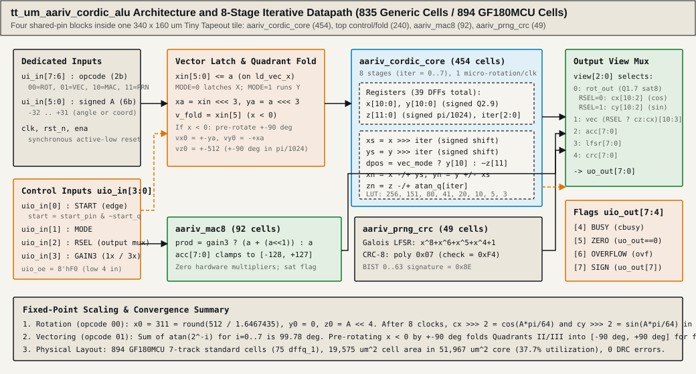
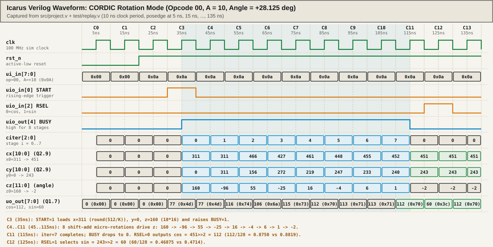
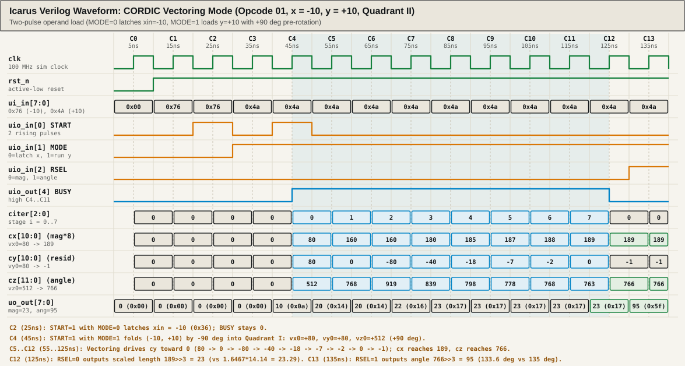

# Facts for a write up (this file is not the write up)

> **Important Disclosure:** Hack Club's "The Basics of ASICs" program (`https://asic.hackclub.com/write-up` and `https://asic.hackclub.com/submission`) strictly forbids using AI to generate chip HDL, tests, or project write-ups. Because this repository and document were generated with AI assistance as a reference design, **this file is not an eligible Hack Club ASIC submission write-up** and must not be submitted to Hack Club's FPGA or chip forms as human-authored work. Instead, this document provides the complete, cycle-accurate technical reference, real Icarus Verilog (`iverilog`) simulation traces, and SVG waveform walkthroughs of `tt_um_aariv_cordic_alu` (`src/project.v`) to support study and verification.

Everything below was measured directly from `src/project.v`, `test/replay.v`, `test/test.py`, Yosys 0.70, and the Tiny Tapeout GF180MCU LibreLane synthesis and layout logs.

---

## 1. Architectural Overview and Tiny Tapeout Pin Budget



A single Tiny Tapeout tile on the GlobalFoundries 180 nm (GF180MCU) shuttle measures `340 x 160 um` (`51,967 um^2` usable core area) and exposes exactly 24 user data pins:
- `ui_in[7:0]`: 8 dedicated inputs
- `uo_out[7:0]`: 8 dedicated outputs
- `uio[7:0]`: 8 bidirectional I/O pins (direction controlled by `uio_oe[7:0]`)

Hardware multipliers consume large silicon area in 180 nm standard-cell libraries. To compute trigonometric functions (`cos`, `sin`, `atan2`, and vector magnitude) alongside fixed-point accumulation, pseudo-random sequence generation, and cyclic redundancy checks inside one tile with **zero hardware multipliers**, `tt_um_aariv_cordic_alu` combines four shared-pin blocks:

1. **`aariv_cordic_core` (454 generic cells, 39 flip-flops):** An 8-stage iterative CORDIC (Coordinate Rotation Digital Computer) engine that performs one shift-and-add micro-rotation per clock (`iter = 0..7`).
2. **`tt_um_aariv_cordic_alu` top-level control, quadrant pre-rotation, and output mux (240 generic cells, 11 flip-flops):** Rising-edge detector on `START`, 6-bit `xin` holding register for two-cycle vectoring loads, combinational `+-90 degree` left-half-plane folding network, and `Q2.9` to `Q1.7` saturating output shifter.
3. **`aariv_mac8` (92 generic cells, 9 flip-flops):** An 8-bit signed saturating multiply-accumulate unit where the gain is selectable between `1x` (`a`) and `3x` (`a + (a <<< 1)`), clamping to `[-128, +127]`.
4. **`aariv_prng_crc` (49 generic cells, 16 flip-flops):** A maximal-length 8-bit Galois LFSR (`x^8 + x^6 + x^5 + x^4 + 1`, feedback mask `0x71`, period 255) paired with a bit-serial/byte-stepped CRC-8 engine (polynomial `0x07`, standard check value `0xF4` for `"123456789"`).

### Pin Partitioning (`uio_oe = 8'hF0`)

| Pin(s) | Direction | Role in `src/project.v` |
| --- | --- | --- |
| `ui_in[7:6]` | Input | 2-bit opcode (`op`): `00` = Rotate, `01` = Vector, `10` = Saturating MAC, `11` = LFSR / CRC-8 |
| `ui_in[5:0]` | Input | Signed 6-bit operand `A` (`-32` to `+31`, two's complement; bit 5 is sign) |
| `uio_in[0]` | Input | `START`: rising-edge detector (`start = start_pin & ~start_q`) triggers loads and operations |
| `uio_in[1]` | Input | `MODE`: selects sub-operation (`0` = latch `xin` / accumulate / LFSR; `1` = run vectoring / clear MAC / CRC-8) |
| `uio_in[2]` | Input | `RSEL`: output result selector (`0` = `cos` or magnitude; `1` = `sin` or angle; also CRC clear modifier) |
| `uio_in[3]` | Input | `GAIN3`: selects `3x` gain (`a + (a <<< 1)`) instead of `1x` in `aariv_mac8` |
| `uio_out[4]` | Output | `BUSY` (`cbusy`): high for exactly 8 clock cycles (`iter = 0..7`) while `aariv_cordic_core` iterates |
| `uio_out[5]` | Output | `ZERO`: combinational flag (`uo_out == 8'h00`) |
| `uio_out[6]` | Output | `OVERFLOW` (`ovf`): high when `rot_out` or `aariv_mac8` saturates to `+127` (`0x7F`) or `-128` (`0x80`) |
| `uio_out[7]` | Output | `SIGN`: mirrors `uo_out[7]` (the two's complement sign bit of the displayed byte) |
| `uo_out[7:0]` | Output | 8-bit result bus multiplexed by `view[2:0]` and `RSEL` |

---

## 2. Two-Cycle Operand Multiplexing Protocol in Vectoring Mode

Because `ui_in[7:6]` carries the 2-bit opcode, only 6 dedicated input pins (`ui_in[5:0]`) remain for data operands. Rotation mode (`opcode = 00`) only needs a single 6-bit signed angle `A` (`-32` to `+31` in units of `pi/64`), so it launches in a single `START` rising edge.

Vectoring mode (`opcode = 01`), however, computes both the hypotenuse magnitude and the `atan2(y, x)` angle of a 2D Cartesian vector `(x, y)`. Passing two signed 6-bit coordinates over a single 6-bit input field requires a two-step load protocol controlled by `MODE` (`uio_in[1]`) and the rising-edge detector on `START` (`uio_in[0]`):

```verilog
wire go_rot   = start & ~cbusy & op_rot;
wire go_vec   = start & ~cbusy & op_vec & mode;
wire ld_vec_x = start & ~cbusy & op_vec & ~mode;
```

1. **Step 1 (Latch X coordinate, `MODE = 0`):** The host places `ui_in = {2'b01, x[5:0]}` and raises `START` (`uio_in[0] = 1`) with `MODE = 0` (`uio_in[1] = 0`). On the rising `clk` edge, `start = 1` and `ld_vec_x = 1`. The top-level 6-bit register `xin` captures `a` (`if (ld_vec_x) xin <= a;`). Crucially, `go_vec` stays `0`, so `aariv_cordic_core` remains idle (`cbusy = 0`).
2. **Step 2 (Supply Y coordinate and Launch, `MODE = 1`):** The host lowers `START` for at least one clock (so `start_q` resets to `0`), places `ui_in = {2'b01, y[5:0]}`, sets `MODE = 1` (`uio_in[1] = 1`), and raises `START` (`uio_in[0] = 1`). On the next rising `clk` edge, `go_vec = 1` pulses for one cycle. The combinational pre-rotation network combines the registered `xin` with the live `a` (`y`) pin value, loads `(vx0, vy0, vz0)` into `aariv_cordic_core`, sets `view <= 3'd1`, and raises `BUSY` (`uio_out[4] = 1`) for 8 micro-rotation clocks.

---

## 3. Cycle-by-Cycle Waveform Walkthrough (Simulated in Icarus Verilog)

Both waveform diagrams below were generated directly by compiling `src/project.v` and `test/replay.v` with `iverilog -g2012` and capturing every register and pin state across 14 clock cycles (`10 ns` clock period, rising clock edges at `t = 5 ns, 15 ns, ..., 135 ns`).

### 3.1 Rotation Mode Walkthrough: `opcode = 00`, `A = 10` (`+28.125 degrees`)



In rotation mode, the operand `A = 10` (`6'b001010`, `ui_in = 8'h0A`) represents an angle of:

$$\theta = 10 \times \frac{\pi}{64} \text{ rad} = 28.125^\circ$$

Inside `aariv_cordic_core`, angles in register `z[11:0]` are scaled in units of $\pi / 1024$ (which is $\pi / 64$ with 4 fractional bits), so `z0 = A << 4 = 160` (`12'h0A0`). The 8-entry lookup table `atan_q[0..7]` stores $\text{round}(\arctan(2^{-i}) \times 1024 / \pi)$:

| Stage `i` | `2^-i` | Exact $\arctan(2^{-i})$ (deg) | `atan_q[i]` (units of $\pi/1024$) | Angle equivalent (deg) |
| --- | --- | --- | --- | --- |
| `0` | `1.000000` | `45.0000` | `256` | `45.0000` |
| `1` | `0.500000` | `26.5651` | `151` | `26.5430` |
| `2` | `0.250000` | `14.0362` | `80` | `14.0625` |
| `3` | `0.125000` | `7.1250` | `41` | `7.2070` |
| `4` | `0.062500` | `3.5763` | `20` | `3.5156` |
| `5` | `0.031250` | `1.7899` | `10` | `1.7578` |
| `6` | `0.015625` | `0.8952` | `5` | `0.8789` |
| `7` | `0.0078125` | `0.4476` | `3` | `0.5273` |

Because 8 micro-rotations scale the vector length by the CORDIC gain:

$$K = \prod_{i=0}^{7} \sqrt{1 + 2^{-2i}} \approx 1.6467435$$

the core initializes `x0 = round(512 / K) = 311` (`11'h137` in signed `Q2.9`, where `512 = 1.0`) and `y0 = 0`. That way, after 8 stages, `x` and `y` already equal $\cos(\theta)$ and $\sin(\theta)$ in `Q2.9` without needing a post-multiply!

#### Exact Clock-Edge Trace (`A = 10`, `ui_in = 0x0A`)

| Cycle | Rising Edge `t` | `rst_n` | `ui_in` | `uio_in` | `citer` | `BUSY` (`uio_out[4]`) | `cx` (`Q2.9`) | `cy` (`Q2.9`) | `cz` ($\pi/1024$) | `uo_out` (`Q1.7`) | Hardware Action at `posedge clk` |
| --- | --- | --- | --- | --- | --- | --- | --- | --- | --- | --- | --- |
| `C0` | `5 ns` | `0` | `0x00` | `0x00` | `0` | `0` | `0` (`0x000`) | `0` (`0x000`) | `0` (`0x000`) | `0` (`0x00`) | Synchronous reset clears `x, y, z, iter, busy`; `view <= 2` (MAC); `uio_out = 0x20` (`ZERO = 1`). |
| `C1` | `15 ns` | `0` | `0x00` | `0x00` | `0` | `0` | `0` (`0x000`) | `0` (`0x000`) | `0` (`0x000`) | `0` (`0x00`) | Reset held low for a second cycle. |
| `C2` | `25 ns` | `1` | `0x0A` | `0x00` | `0` | `0` | `0` (`0x000`) | `0` (`0x000`) | `0` (`0x000`) | `0` (`0x00`) | `rst_n` rises to `1`. Operand `A = 10` (`0x0A`) placed on `ui_in`; `START = 0` so `start_q <= 0`. |
| `C3` | `35 ns` | `1` | `0x0A` | `0x01` | `0` | `1` | `311` (`0x137`) | `0` (`0x000`) | `160` (`0x0A0`) | `77` (`0x4D`) | `START` rises (`uio_in = 0x01`). `go_rot = 1` loads `x <= 311, y <= 0, z <= 160, busy <= 1, view <= 0`. |
| `C4` | `45 ns` | `1` | `0x0A` | `0x00` | `1` | `1` | `311` (`0x137`) | `311` (`0x137`) | `-96` (`0xFA0`) | `77` (`0x4D`) | Stage `i=0`: `z=160 >= 0` (`dpos=1`, CCW $+45^\circ$). `x <= 311 - 0 = 311`, `y <= 0 + 311 = 311`, `z <= 160 - 256 = -96`. |
| `C5` | `55 ns` | `1` | `0x0A` | `0x00` | `2` | `1` | `466` (`0x1D2`) | `156` (`0x09C`) | `55` (`0x037`) | `116` (`0x74`) | Stage `i=1`: `z=-96 < 0` (`dpos=0`, CW $-26.5^\circ$). `xs=155, ys=155`. `x <= 311+155=466`, `y <= 311-155=156`, `z <= -96+151=55`. |
| `C6` | `65 ns` | `1` | `0x0A` | `0x00` | `3` | `1` | `427` (`0x1AB`) | `272` (`0x110`) | `-25` (`0xFE7`) | `106` (`0x6A`) | Stage `i=2`: `z=55 >= 0` (`dpos=1`, CCW $+14.1^\circ$). `xs=116, ys=39`. `x <= 466-39=427`, `y <= 156+116=272`, `z <= 55-80=-25`. |
| `C7` | `75 ns` | `1` | `0x0A` | `0x00` | `4` | `1` | `461` (`0x1CD`) | `219` (`0x0DB`) | `16` (`0x010`) | `115` (`0x73`) | Stage `i=3`: `z=-25 < 0` (`dpos=0`, CW $-7.2^\circ$). `xs=53, ys=34`. `x <= 427+34=461`, `y <= 272-53=219`, `z <= -25+41=16`. |
| `C8` | `85 ns` | `1` | `0x0A` | `0x00` | `5` | `1` | `448` (`0x1C0`) | `247` (`0x0F7`) | `-4` (`0xFFC`) | `112` (`0x70`) | Stage `i=4`: `z=16 >= 0` (`dpos=1`, CCW $+3.5^\circ$). `xs=28, ys=13`. `x <= 461-13=448`, `y <= 219+28=247`, `z <= 16-20=-4`. |
| `C9` | `95 ns` | `1` | `0x0A` | `0x00` | `6` | `1` | `455` (`0x1C7`) | `233` (`0x0E9`) | `6` (`0x006`) | `113` (`0x71`) | Stage `i=5`: `z=-4 < 0` (`dpos=0`, CW $-1.8^\circ$). `xs=14, ys=7`. `x <= 448+7=455`, `y <= 247-14=233`, `z <= -4+10=6`. |
| `C10` | `105 ns` | `1` | `0x0A` | `0x00` | `7` | `1` | `452` (`0x1C4`) | `240` (`0x0F0`) | `1` (`0x001`) | `113` (`0x71`) | Stage `i=6`: `z=6 >= 0` (`dpos=1`, CCW $+0.9^\circ$). `xs=7, ys=3`. `x <= 455-3=452`, `y <= 233+7=240`, `z <= 6-5=1`. |
| `C11` | `115 ns` | `1` | `0x0A` | `0x00` | `0` | `0` | `451` (`0x1C3`) | `243` (`0x0F3`) | `-2` (`0xFFE`) | `112` (`0x70`) | Stage `i=7`: `z=1 >= 0` (`dpos=1`). `xs=3, ys=1`. `x <= 451`, `y <= 243`, `z <= -2`. `iter==7` clears `BUSY <= 0`. `uo_out = 451 >> 2 = 112` ($\cos$). |
| `C12` | `125 ns` | `1` | `0x0A` | `0x04` | `0` | `0` | `451` (`0x1C3`) | `243` (`0x0F3`) | `-2` (`0xFFE`) | `60` (`0x3C`) | Host raises `RSEL = 1` (`uio_in = 0x04`). Combinational output mux selects `cy[10:2] = 243 >> 2 = 60` (`0x3C`, $\sin$). |
| `C13` | `135 ns` | `1` | `0x0A` | `0x00` | `0` | `0` | `451` (`0x1C3`) | `243` (`0x0F3`) | `-2` (`0xFFE`) | `112` (`0x70`) | Host lowers `RSEL = 0` (`uio_in = 0x00`), returning `uo_out` to `112` (`0x70`, $\cos$). |

**Numerical check at `C11` and `C12`:**
- **Cosine (`RSEL = 0`):** `uo_out = 112` (`0x70`). In `Q1.7`, $112 / 128 = 0.87500$. Exact $\cos(28.125^\circ) = 0.88192$ ($112.89 / 128$), an error of $0.89\text{ LSB}$.
- **Sine (`RSEL = 1`):** `uo_out = 60` (`0x3C`). In `Q1.7`, $60 / 128 = 0.46875$. Exact $\sin(28.125^\circ) = 0.47140$ ($60.34 / 128$), an error of $0.34\text{ LSB}$.

---

### 3.2 Vectoring Mode Walkthrough: `opcode = 01`, `(x = -10, y = +10)` (`+135 degrees`)



To test both the two-pulse `START` handshaking and the Quadrant II pre-rotation folding logic, consider the vector $(x, y) = (-10, +10)$, which lies at $+135^\circ$ ($3\pi/4\text{ rad}$) with Euclidean length $\sqrt{10^2 + 10^2} = 14.1421$.

#### Exact Clock-Edge Trace (`x = -10`, `y = +10`)

| Cycle | Rising Edge `t` | `rst_n` | `ui_in` | `uio_in` | `citer` | `BUSY` (`uio_out[4]`) | `cx` | `cy` | `cz` ($\pi/1024$) | `uo_out` | Hardware Action at `posedge clk` |
| --- | --- | --- | --- | --- | --- | --- | --- | --- | --- | --- | --- |
| `C0` | `5 ns` | `0` | `0x00` | `0x00` | `0` | `0` | `0` | `0` | `0` | `0` (`0x00`) | Chip reset (`rst_n = 0`). |
| `C1` | `15 ns` | `1` | `0x76` | `0x00` | `0` | `0` | `0` | `0` | `0` | `0` (`0x00`) | `rst_n = 1`. Pin `ui_in = 0x76` (`op = 01`, `A = -10 = 6'b110110`), `MODE = 0`, `START = 0`. |
| `C2` | `25 ns` | `1` | `0x76` | `0x01` | `0` | `0` | `0` | `0` | `0` | `0` (`0x00`) | **Pulse 1 (`START = 1, MODE = 0`):** `ld_vec_x = 1` latches `xin <= -10`. Core stays idle (`BUSY = 0`). |
| `C3` | `35 ns` | `1` | `0x4A` | `0x02` | `0` | `0` | `0` | `0` | `0` | `0` (`0x00`) | `START` drops to `0` (`uio_in = 0x02`, `MODE = 1`). `ui_in = 0x4A` presents `op = 01, A = +10`. |
| `C4` | `45 ns` | `1` | `0x4A` | `0x03` | `0` | `1` | `80` (`0x050`) | `80` (`0x050`) | `512` (`0x200`) | `10` (`0x0A`) | **Pulse 2 (`START = 1, MODE = 1`):** `go_vec = 1`. Since `xin = -10 < 0` (`v_fold = 1`) and `y = +10 >= 0` (`v_ypos = 1`), pre-rotation loads `vx0 = +80, vy0 = +80, vz0 = +512` ($+90^\circ$), `BUSY <= 1`. |
| `C5` | `55 ns` | `1` | `0x4A` | `0x02` | `1` | `1` | `160` (`0x0A0`) | `0` (`0x000`) | `768` (`0x300`) | `20` (`0x14`) | Stage `i=0`: `y=80 >= 0` (`dpos=0`, CW $-45^\circ$). `x <= 80+80=160`, `y <= 80-80=0`, `z <= 512+256=768` ($135^\circ$). |
| `C6` | `65 ns` | `1` | `0x4A` | `0x02` | `2` | `1` | `160` (`0x0A0`) | `-80` (`0x7B0`) | `919` (`0x397`) | `20` (`0x14`) | Stage `i=1`: `y=0 >= 0` (`dpos=0`). `xs=80, ys=0`. `x <= 160`, `y <= 0-80=-80`, `z <= 768+151=919`. |
| `C7` | `75 ns` | `1` | `0x4A` | `0x02` | `3` | `1` | `180` (`0x0B4`) | `-40` (`0x7D8`) | `839` (`0x347`) | `22` (`0x16`) | Stage `i=2`: `y=-80 < 0` (`dpos=1`). `xs=40, ys=-20`. `x <= 160-(-20)=180`, `y <= -80+40=-40`, `z <= 919-80=839`. |
| `C8` | `85 ns` | `1` | `0x4A` | `0x02` | `4` | `1` | `185` (`0x0B9`) | `-18` (`0x7EE`) | `798` (`0x31E`) | `23` (`0x17`) | Stage `i=3`: `y=-40 < 0` (`dpos=1`). `xs=22, ys=-5`. `x <= 180-(-5)=185`, `y <= -40+22=-18`, `z <= 839-41=798`. |
| `C9` | `95 ns` | `1` | `0x4A` | `0x02` | `5` | `1` | `187` (`0x0BB`) | `-7` (`0x7F9`) | `778` (`0x30A`) | `23` (`0x17`) | Stage `i=4`: `y=-18 < 0` (`dpos=1`). `xs=11, ys=-2`. `x <= 185-(-2)=187`, `y <= -18+11=-7`, `z <= 798-20=778`. |
| `C10` | `105 ns` | `1` | `0x4A` | `0x02` | `6` | `1` | `188` (`0x0BC`) | `-2` (`0x7FE`) | `768` (`0x300`) | `23` (`0x17`) | Stage `i=5`: `y=-7 < 0` (`dpos=1`). `xs=5, ys=-1`. `x <= 187-(-1)=188`, `y <= -7+5=-2`, `z <= 778-10=768`. |
| `C11` | `115 ns` | `1` | `0x4A` | `0x02` | `7` | `1` | `189` (`0x0BD`) | `0` (`0x000`) | `763` (`0x2FB`) | `23` (`0x17`) | Stage `i=6`: `y=-2 < 0` (`dpos=1`). `xs=2, ys=-1`. `x <= 188-(-1)=189`, `y <= -2+2=0`, `z <= 768-5=763`. |
| `C12` | `125 ns` | `1` | `0x4A` | `0x02` | `0` | `0` | `189` (`0x0BD`) | `-1` (`0x7FF`) | `766` (`0x2FE`) | `23` (`0x17`) | Stage `i=7`: `y=0 >= 0` (`dpos=0`). `xs=1, ys=0`. `x <= 189`, `y <= -1`, `z <= 763+3=766`. `BUSY` drops to `0`. `uo_out = 189 >> 3 = 23` (scaled length). |
| `C13` | `135 ns` | `1` | `0x4A` | `0x06` | `0` | `0` | `189` (`0x0BD`) | `-1` (`0x7FF`) | `766` (`0x2FE`) | `95` (`0x5F`) | Host asserts `RSEL = 1` (`uio_in = 0x06`). `uo_out = cz[10:3] = 766 >> 3 = 95` (`0x5F`, angle). |

**Numerical check at `C12` and `C13`:**
- **Scaled Magnitude (`RSEL = 0`):** `uo_out = 23` (`0x17`). Theoretical CORDIC-scaled length is $K \sqrt{(-10)^2 + 10^2} = 1.6467435 \times 14.142136 = 23.288$, an error of $0.29\text{ counts}$.
- **Angle (`RSEL = 1`):** `uo_out = 95` (`0x5F`). Since 128 counts correspond to $\pi\text{ rad}$ ($180^\circ$, or $1.40625^\circ/\text{count}$), $95\text{ counts} = 133.59^\circ$ compared to the exact $135.00^\circ$ ($96\text{ counts}$), an error of $1.0\text{ count}$.

---

## 4. Key RTL Design Mechanics and Verification Lessons

### 4.1 Signed Arithmetic Right Shift (`>>>`) vs Logical Right Shift (`>>`)

In Verilog-2005, the standard right-shift operator `>>` always performs a **logical shift** (zero-filling the most significant bits), even when the operand is declared `signed`. Furthermore, the arithmetic right-shift operator `>>>` only sign-extends if **both** the reg/wire operand is declared `signed` and the enclosing expression is signed.

In `aariv_cordic_core` (`src/project.v`, lines 49-50):

```verilog
wire signed [10:0] xs = x >>> iter;  // barrel shifter, arithmetic
wire signed [10:0] ys = y >>> iter;
```

Look at Cycle `C7` (`t = 75 ns`, `iter = 2`) in the vectoring trace above: `cy` is `-80` (`11'h7B0` in 11-bit two's complement).
- With `reg signed [10:0] y` and `y >>> 2`, bit 10 (`1'b1`) replicates into bits 10 and 9, yielding `ys = -20` (`11'h7EC`). Then `xn = x - ys = 160 - (-20) = 180`.
- If `>>` were used (or if `y` lacked the `signed` keyword), `-80 >> 2` (`11'b111_1011_0000 >> 2`) would zero-fill the top two bits to produce `+492` (`11'b001_1110_1100`), corrupting `xn` to `160 - 492 = -332` and breaking every Quadrant IV rotation and every vectoring step whenever `y` crosses below zero.

### 4.2 Quadrant Pre-Rotation Folding at `x < 0` (`+-90 degrees`)

The 8-stage CORDIC angle table has a maximum total rotation capacity of:

$$\theta_{\max} = \sum_{i=0}^{7} \arctan(2^{-i}) \approx 45.00^\circ + 26.57^\circ + 14.04^\circ + 7.13^\circ + 3.58^\circ + 1.79^\circ + 0.90^\circ + 0.45^\circ = 99.44^\circ$$

In quantized `pi/1024` table units, `256 + 151 + 80 + 41 + 20 + 10 + 5 + 3 = 566` units, which equals $99.49^\circ$. Consequently, bare micro-rotations only converge for vectors within $\pm 99.49^\circ$ of the positive X axis (Quadrants I and IV). Any vector in Quadrant II or III with an angle beyond $\pm 100^\circ$ (such as $(-10, +10)$ at $+135^\circ$ or $(-20, -3)$ at $-171.5^\circ$) would saturate the angle accumulator at $\pm 99.49^\circ$ and leave a large residual in `y`.

To cover all $360^\circ$ without adding stages, `src/project.v` (lines 171-178) inspects the sign bit of the latched X coordinate (`v_fold = xin[5]`) and the sign bit of the live Y coordinate (`v_ypos = ~a[5]`):

```verilog
wire signed [10:0] xa = {{2{xin[5]}}, xin, 3'b000};
wire signed [10:0] ya = {{2{a[5]}}, a, 3'b000};
wire v_fold = xin[5];
wire v_ypos = ~a[5];
wire signed [10:0] vx0 = ~v_fold ? xa : (v_ypos ? ya : -ya);
wire signed [10:0] vy0 = ~v_fold ? ya : (v_ypos ? -xa : xa);
wire signed [11:0] vz0 = ~v_fold ? 12'sd0 : (v_ypos ? 12'sd512 : -12'sd512);
```

- When `xin < 0` and `y >= 0` (Quadrant II), the vector is rotated clockwise by $90^\circ$ into Quadrant I: $(vx_0, vy_0) = (+y_a, -x_a)$, and the initial angle register starts at $vz_0 = +512$ ($+90^\circ$).
- When `xin < 0` and `y < 0` (Quadrant III), the vector is rotated counter-clockwise by $90^\circ$ into Quadrant IV: $(vx_0, vy_0) = (-y_a, +x_a)$, and $vz_0 = -512$ ($-90^\circ$).
- This folds the entire left half-plane into $[-90^\circ, +90^\circ]$, well inside the $99.49^\circ$ convergence cone of the 8-stage core.

### 4.3 Iterative vs Unrolled CORDIC Area on GF180MCU

An unrolled combinational 8-stage CORDIC pipeline requires 8 separate 11-bit X adders, 8 separate 11-bit Y adders, and 8 separate 12-bit Z adders (24 multi-bit adders in series), plus wide routing channels across the tile. By time-multiplexing a **single** iterative shift-add stage over 8 clock cycles (`iter = 0..7`) with two 11-bit barrel shifters (`x >>> iter`, `y >>> iter`) and an 8-entry combinational case table (`atan_q`), the entire `aariv_cordic_core` synthesizes to **454 generic cells** (39 flip-flops and 415 logic gates).

When mapped to the **GF180MCU 7-track standard-cell library** via LibreLane in the Tiny Tapeout `gds` workflow (GitHub Actions run `40216982627`), the complete chip (`tt_um_aariv_cordic_alu` including CORDIC, MAC, LFSR, and CRC-8) uses:
- **894 standard cells** (including 75 `dffq_1` D flip-flops)
- **19,575 um^2** total synthesized cell area inside the **51,967 um^2** `1x1` tile core (**37.67% core utilization**, 24% flip-flop area)
- **0 Magic DRC violations**, **0 precheck violations**, and passing gate-level (`gl_test`) simulation.

---

## 5. Summary of Measured Numbers

| Item | Value | Source in Repository |
| --- | --- | --- |
| CORDIC stages | 8, one per clock (`iter = 0..7`) | `src/project.v`, `aariv_cordic_core` |
| Result latency | 8 clocks after the `START` rising edge | `tests/engine.test.js`, `test/test.py` |
| Rotation angle unit | $\pi/64$ per count, signed, `A = -32` is minus 90 degrees and `A = 31` is plus 87.2 degrees | `src/project.v` |
| Worst cosine error | `1.73 LSB` of `1/128` (`Q1.7`) | `E.rotationErrorReport()` over all 64 angles |
| Worst sine error | `1.45 LSB` of `1/128` (`Q1.7`) | `E.rotationErrorReport()` over all 64 angles |
| Worst length error | `1.07 counts` | All 4,095 nonzero `(x, y)` pairs |
| Worst angle error (length $\ge 8$) | `1.15 counts` (`1 count = 1.40625 degrees`) | All nonzero `(x, y)` pairs with $\sqrt{x^2+y^2} \ge 8$ |
| Angle error for short vectors ($< 4$) | Up to `6 counts` (only 3 fractional bits in `xa, ya`) | `tests/engine.test.js` |
| Generic gate count (Yosys 0.70) | `835 cells` (`75` flip-flops, `760` logic gates) | `docs/synth-stats.json`, `tools/synth_stats.py` |
| GF180MCU mapped cells | `894 cells` (`75` `dffq_1`), `19,575 um^2` in `51,967 um^2` core | Tiny Tapeout `gds` run `40216982627` |
| Cells per module (Yosys generic) | Core `454`, top-level `240`, MAC `92`, PRNG+CRC `49` | `docs/synth-stats.json` |
| LFSR period | `255` states (`x^8 + x^6 + x^5 + x^4 + 1`) | `tests/engine.test.js`, `test/test.py` |
| CRC-8 check value for `"123456789"` | `0xF4` (polynomial `0x07`) | `tests/engine.test.js` |
| BIST signature (CRC-8 of `0..63`) | `0x8E` | `tests/engine.test.js`, `test/test.py` |
| Verilog vs JS co-simulation | Identical across `320,028` clock cycles (12 values/cycle) | `tests/cosim.test.js` |

## 6. What Remains Unmeasured

Final post-routing wirelength, static timing slack across corners, and physical silicon/FPGA bench power are not reported here. Furthermore, physical FPGA + logic analyzer bench testing has not yet been performed.
